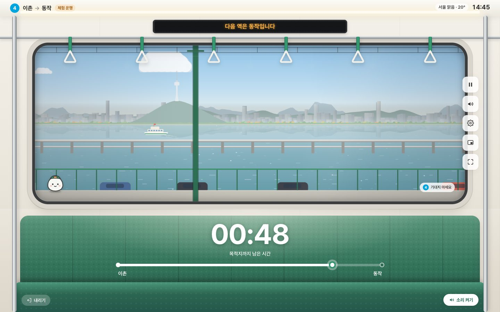
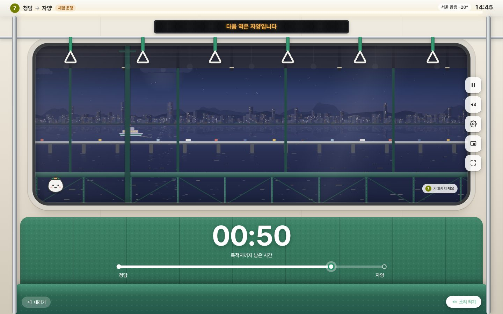
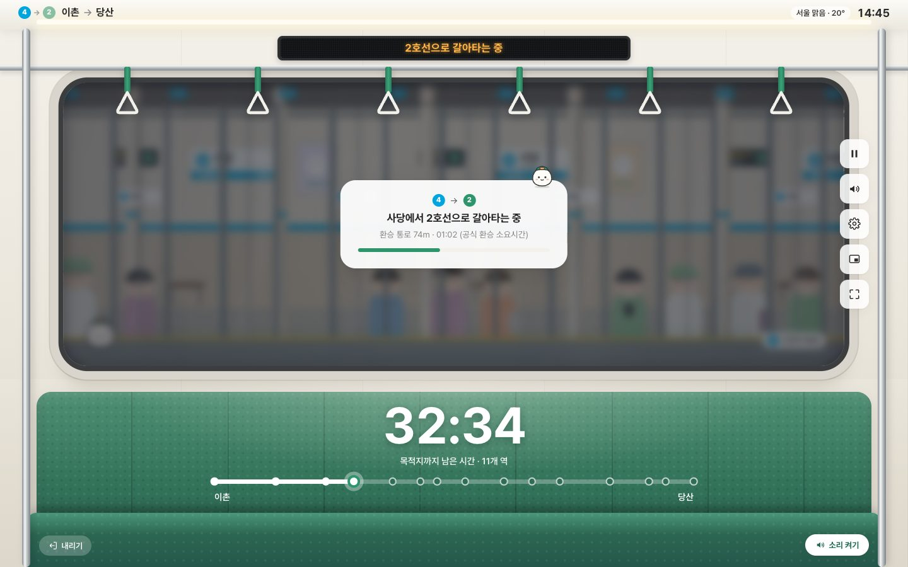
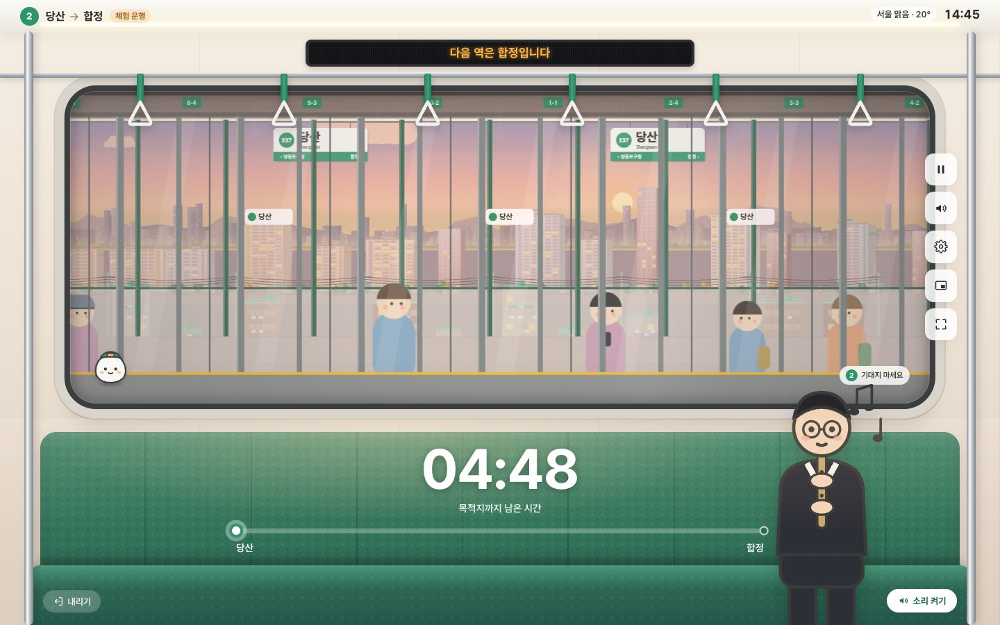
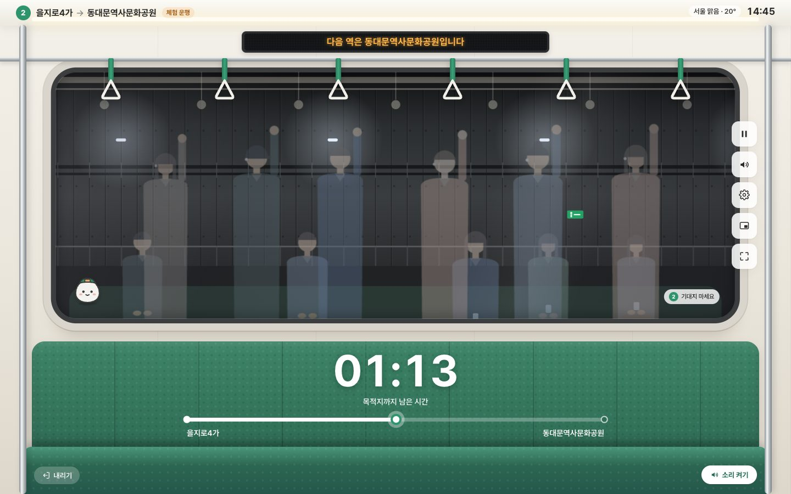
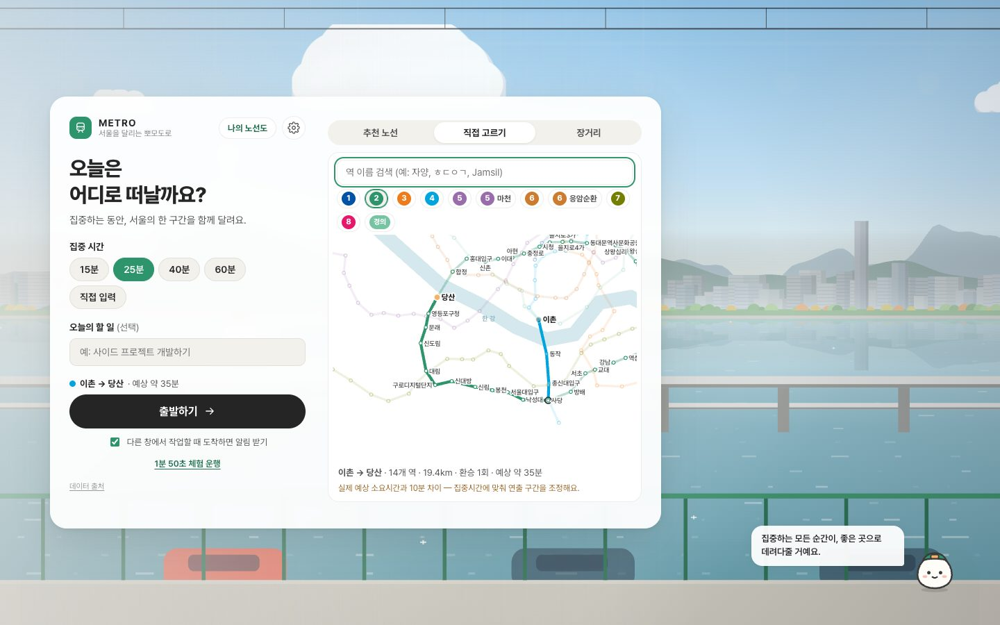
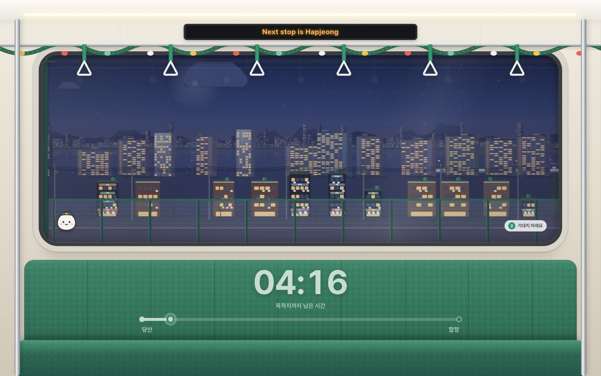
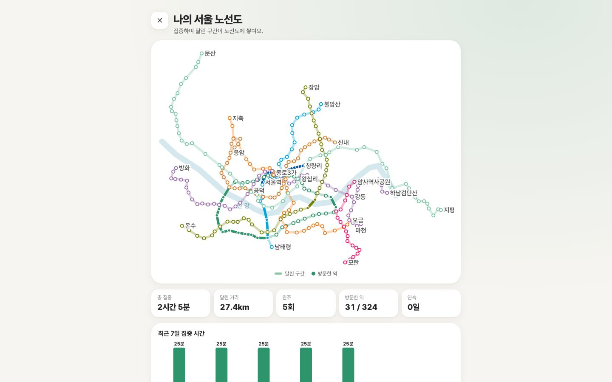
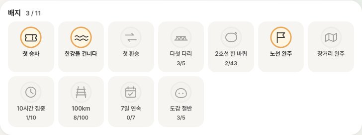

<div align="center">


# METRO

**A Pomodoro timer that rides the Seoul subway**

While you focus, sit by the window of a Seoul subway car and ride one stretch of a real line.

[](https://github.com/yohan-work/pomotro/actions/workflows/ci.yml)
[](LICENSE)
[](#data-and-attribution)
[](https://nextjs.org)
[](tsconfig.json)
[](public/sw.js)
[](https://pomotro.vercel.app)

**[▶ Ride now — pomotro.vercel.app](https://pomotro.vercel.app)**

[한국어](README.md) · English

[Features](#features) · [Quick start](#quick-start) · [How it works](#how-it-works) · [Data](#data-and-attribution) · [Architecture](docs/architecture.md) · [Contributing](CONTRIBUTING.md)


</div>

---

## About

METRO turns a focus session into **a small trip across Seoul**.

Pick 25 minutes and it suggests a real subway route that takes about that long. Then you sit by the window: the doors close, the train accelerates smoothly, crosses the Han River, slips through tunnels and brakes into the next station. When you arrive, your session is done and you get a ticket.

- **Real data** — station order, run times, distances, coordinates and transfer walks for 278 stations on 9 lines come straight from Seoul Metro, the Seoul Metropolitan Government and the Korea National Railway open data.
- **Just the browser** — Canvas 2D parallax and synthesized WebAudio, no external images or audio. A server is used only for the anonymous "who's riding now" count (everything else works without it).
- **A pure function of time** — the train's position depends only on elapsed time. Switch tabs or reload and the same moment shows the same scene.

The app itself is fully available in English (official English station names and English announcements).

## Features

### Ride real lines

- **9 lines, 11 routes** — Lines 1–8 (Seoul Metro sections) and the Gyeongui–Jungang Line, including the Line 5 Macheon branch and the Line 6 Eungam loop
- **Transfers** — pick a station on another line and it finds a route using official transfer walking distances and times. You walk through the transfer and board the next train on the new line's platform
- **Routes that fit your time** — 15/25/40/60 minutes or custom; scenic Han River crossings and elevated sections are favored
- **Station search** — Korean, Korean initial consonants (ㅎㄷㅇㄱ) or English
- **Long trips** — ride long courses like the full Line 2 loop, the five Han River bridges or the whole Gyeongui–Jungang Line a little at a time

### Seoul out the window

- **Five Han River bridges** — Dangsan (Yanghwa Bridge, Seonyudo, sunsets), Jamsil (Lotte World Tower), Dongho and Dongjak (down the middle of a road bridge, cars passing beside you), Cheongdam (the lower deck, with the road deck overhead)
- **Real directions** — you always face the left-hand window, so the same bridge looks different northbound and southbound
- **Neighborhoods** — red-brick Seongsu, glass offices of the Guro Digital Complex, Paldang Lake and greenhouses along the Gyeongui–Jungang Line
- **Underground, never dull** — box, round (shield) and pillared tunnels, passing trains, "Transfer" signs at interchange stations, passengers reflected in the glass
- **Real sky and seasons** — sunsets at Seoul's actual sunset time, live Seoul weather (rain, snow, fog), forsythia → cherry blossoms → fresh green, December decorations

### Ride together

- **Ride-together links** — send a link and whoever opens it boards the same line at the same departure time; since the simulation is a pure function of time, everyone sees the same view. "Riding together · 3"
- **Who's riding now** — "12 focusing on Line 2 now". Only an anonymous beat (a random per-tab id, the line and the room) is sent once a minute and deleted after 150 seconds. No names or device info are stored, and you can turn it off

### A daily focus tool

- **Pomodoro cycle** — take your break parked at the station you arrived at (5 min, 15 every 4th), then continue from the same station
- **Accurate timer** — wall-clock based; survives pause, tab switches and reloads, with a notification when you arrive
- **Mini window** — a small always-on-top window with the view, time left and next stop (Document Picture-in-Picture)
- **Focus mode** — after 5 seconds without input only the window and the time remain (`H`)
- **Installable** — add to home screen, works offline (PWA)

### Records and fun

- **Tickets and highlight videos** — get a ticket on arrival and a 15-second video of the bridges and moments of your ride to share
- **My Seoul map** — the sections you rode and stations you visited build up on a map drawn from official coordinates, with progress per line, total time, distance and streaks
- **Daily goal · weekly recap** — a progress ring for "4 rides today", and this week's rides, focus time and new stations on one shareable card
- **12 badges** — first transfer, five bridges, a full Line 2 loop, a finished long trip, daily goal…
- **Surprises** — now and then a passenger with a danso flute sits across from you, or swan boats and a hot-air balloon pass outside. Very rarely, the Han River monster (?). Everything you spot goes into your collection

### For everyone

- **Korean · English** UI
- **Accessibility** — reduced motion (no sway or animations), no flashing, keyboard control, screen reader announcements
- **Announcements and synthesized sound** — "This stop is Hapjeong", rolling noise, rail joints, tunnel reverb, chimes (per-channel volume)

## Screenshots

| Sunset · Dangsan Bridge | Dongjak Bridge · Namsan | Under Cheongdam Bridge · night |
|:---:|:---:|:---:|
|  |  |  |
| **Transfer at Sadang** | **Surprise passenger** | **Reflections in a tunnel** |
|  |  |  |
| **Start screen** | **Search · transfer route** | **Christmas Eve** |
|  |  |  |
| **Ticket · new badge** | **My Seoul map** | **Badges** |
|  |  |  |

## Quick start

Try it without installing at **[pomotro.vercel.app](https://pomotro.vercel.app)**.

To run locally you need Node.js 24+.

```bash
git clone https://github.com/yohan-work/pomotro.git
cd pomotro
npm install
npm run dev
```

Open <http://localhost:3000> and press **1:50 trial ride · Dangsan → Hapjeong**. Sound starts after you press a start button.

| Key | Action |
|---|---|
| `Space` | Pause / resume |
| `H` | Focus mode (hide controls) |
| `Esc` | Close panels |

## How it works

```
epochNow() ─▶ elapsed t ─▶ sampleJourney(journey, t) ─▶ position · speed · acceleration · phase (stop/transfer/run)
                                 │
             ┌───────────────────┼────────────────────┬─────────────────────┐
             ▼                   ▼                    ▼                     ▼
      Canvas 2D renderer    WebAudio engine      DOM cabin · HUD        Mini window · highlight video
      (12 parallax layers)  (speed-reactive)     (React, ≤4 Hz)         (redraw the same function)
```

- **State is a pure function of time.** Nothing accumulates per frame, so hidden tabs and reloads show the same scene at the same moment; the mini window and highlight video simply redraw the same function on another canvas.
- **When focus time ≠ real run time**, playback speed never changes — scenic sections (tunnels, city) stretch or shrink so the train always moves at realistic speeds.
- **Scenery** is generated deterministically per track-coordinate cell — the same place always has the same buildings — and expensive drawings are cached as offscreen sprites.
- **Surprises** are seeded by the session id, so after a reload the same passenger boards at the same station.

More in [docs/architecture.md](docs/architecture.md) and [docs/design-system.md](docs/design-system.md) (Korean).

## Data and attribution

| Data | Source | Status |
|---|---|---|
| Lines 1–8 station order, run times, distances | [Seoul Metro “Distance and travel time between stations”](https://data.seoul.go.kr/dataList/OA-12034/S/1/datasetView.do) | ✅ official |
| Station coordinates | [Seoul “Station master”](https://data.seoul.go.kr/dataList/OA-21232/S/1/datasetView.do) | ✅ official |
| Station codes, English names | Seoul “Subway stations by line” (Seoul Open Data Plaza API) | ✅ official |
| Transfer distances and times | [Seoul Metro “Transfer distance and time”](https://www.data.go.kr/data/15044419/fileData.do) | ✅ official |
| Gyeongui–Jungang distances, locations, English names | Korea National Railway ([distances](https://www.data.go.kr/data/15041327/fileData.do), [locations](https://www.data.go.kr/data/15041487/fileData.do), [RAFIS](https://www.data.go.kr/data/15132601/fileData.do)) | ✅ official |
| Gyeongui–Jungang run times | No open data → estimated from distance | shown as “estimated” |
| Dwell times, transfer waits | estimated | shown as “approx.” |
| Above/below ground, landmarks | public information | ⚠️ not yet verified |
| Scenery lengths, layouts, tunnel types, crowding, surprises | art direction (`src/data/scenery.ts` etc.) | not real measurements |

Official data is downloaded by `npm run data:import`, stored as raw CSV in `data/official/`, and turned into generated `src/data/*.official.ts` files that are never edited by hand. Real-world facts and art-direction values live in separate files. Attribution: [NOTICE.md](NOTICE.md).

## Development

| Command | Description |
|---|---|
| `npm run dev` | Dev server |
| `npm run build` / `npm start` | Production build (static) / serve |
| `npm run typecheck` | TypeScript |
| `npm test` | Unit tests (vitest) |
| `npm run test:sim` | Simulation invariants + official data consistency |
| `npm run verify:behavior -- <url>` | Behavior checks in real Chrome (pause, reload, transfers, mini window, video…) |
| `npm run visual:diff -- <base> <head>` | Pixel diff of 32 frozen scenes (CI runs main vs PR) |
| `npm run data:import` | Re-download official data (`SEOUL_OPENAPI_KEY` in `.env.local` for coordinates and English names) |

CI runs typecheck, unit tests, simulation checks and the build, behavior checks in Chrome, and a main-vs-PR scene pixel diff on every pull request. Merges to `main` deploy to Vercel.

## Contributing

Bug reports, data corrections and scenery or sound ideas are all welcome — see [CONTRIBUTING.md](CONTRIBUTING.md) and the [Code of Conduct](CODE_OF_CONDUCT.md). Report security issues privately as described in [SECURITY.md](SECURITY.md). Issues and PRs in English are fine.

## License

- Code: [MIT](LICENSE)
- Route, station and transfer data: open data of the respective agencies (KOGL Type 1 etc.) — see [NOTICE.md](NOTICE.md)
- Font: [Pretendard](https://github.com/orioncactus/pretendard) (SIL OFL 1.1)
- Weather: [Open-Meteo](https://open-meteo.com) (CC BY 4.0)

METRO is a personal project and is not affiliated with Seoul Metro, the Seoul Metropolitan Government or the Korea National Railway. Station signs and displays in the app are original designs.
