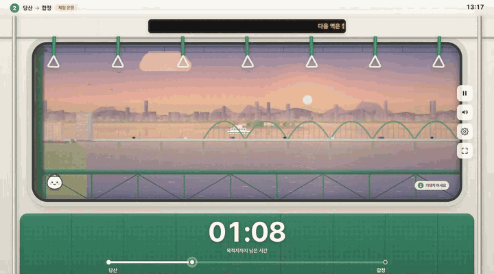
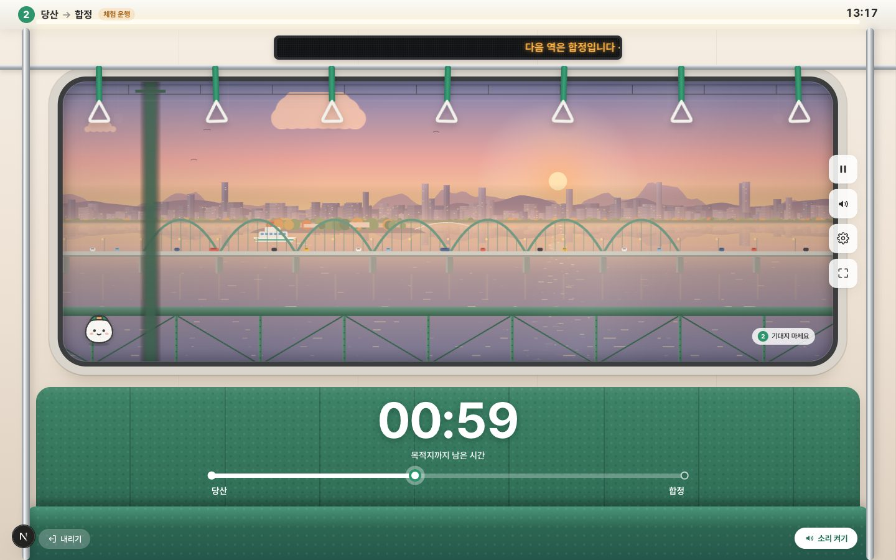
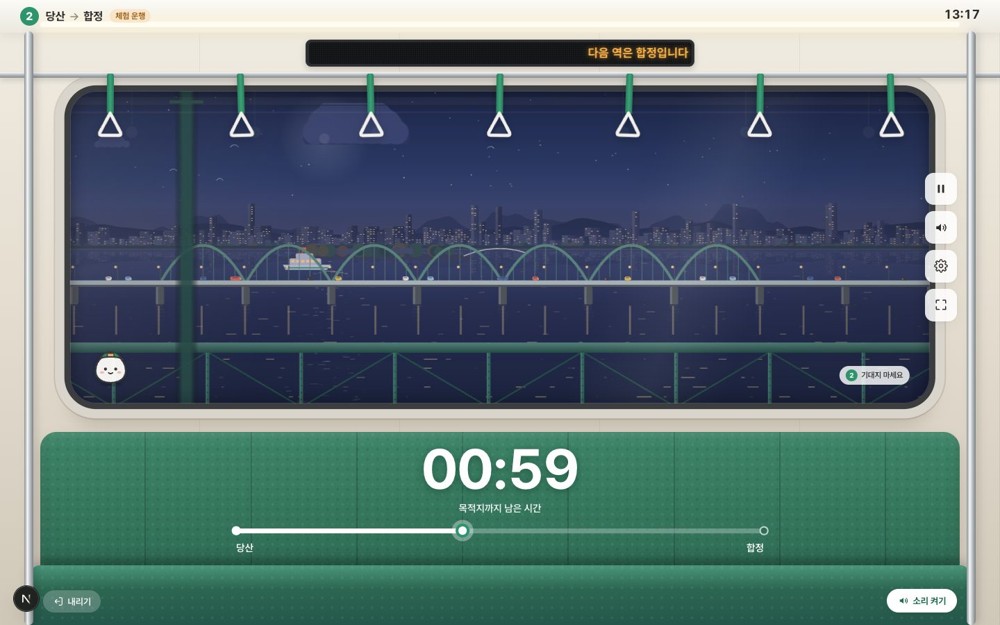
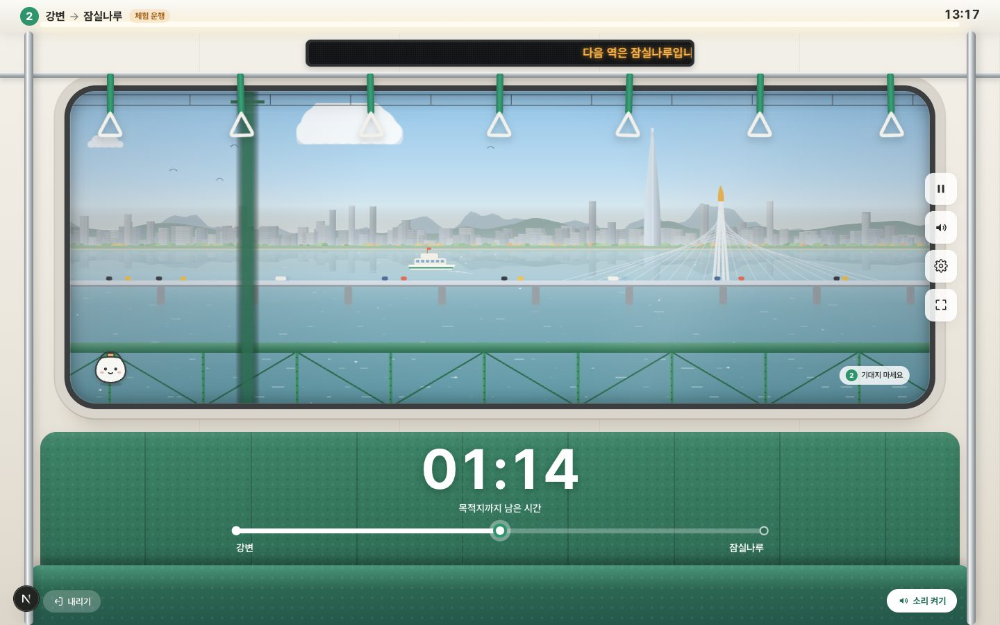
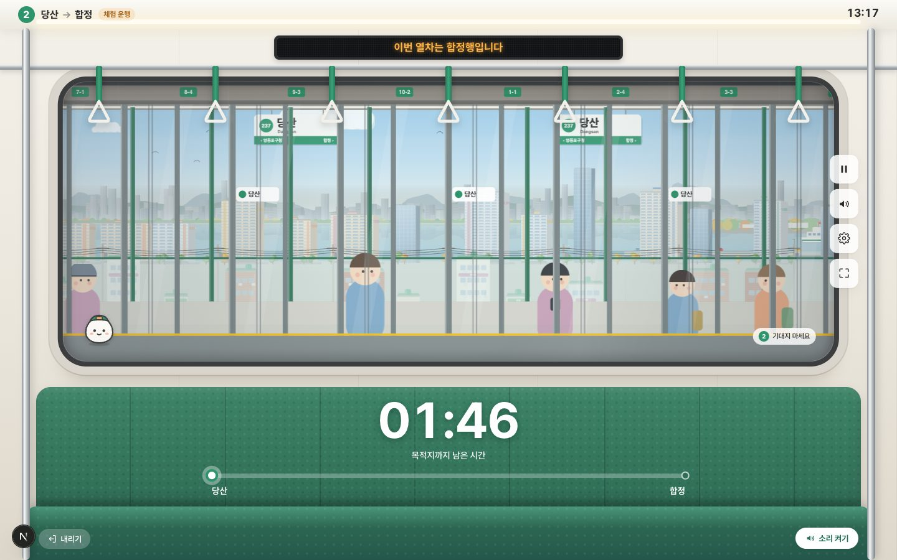
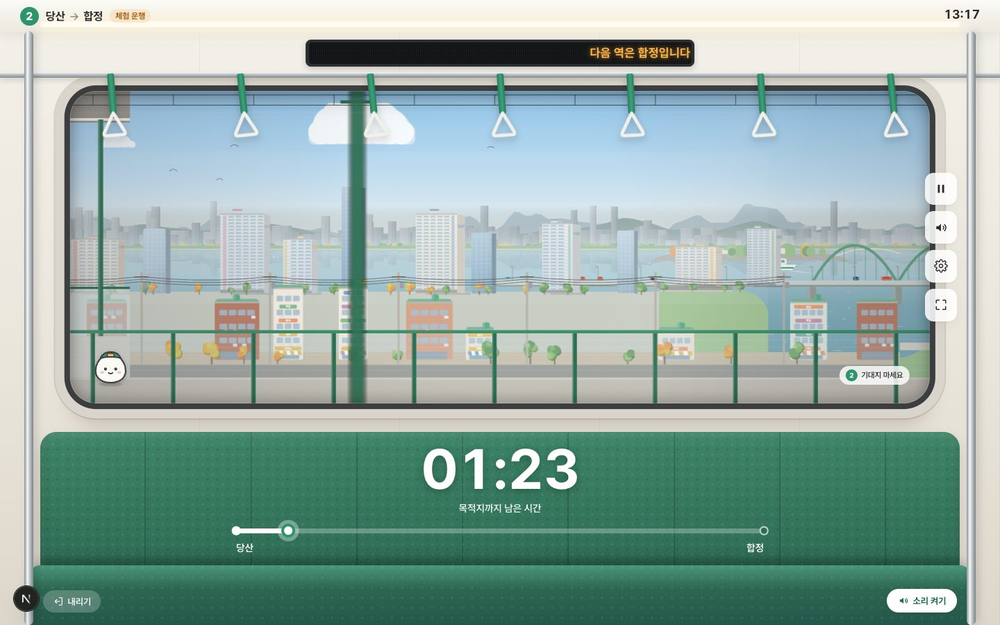
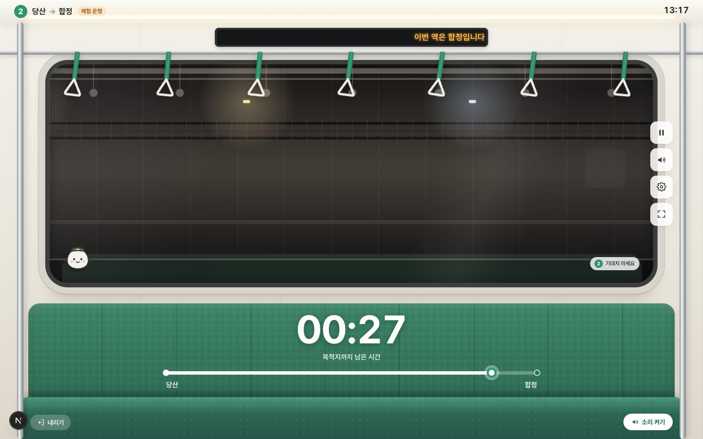
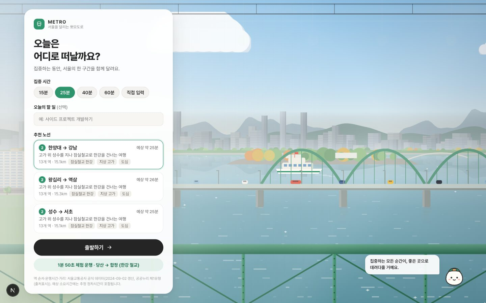
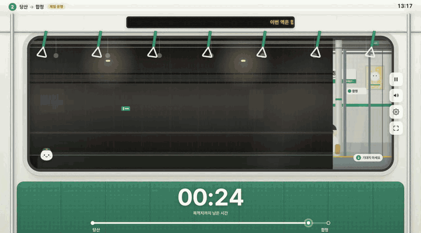
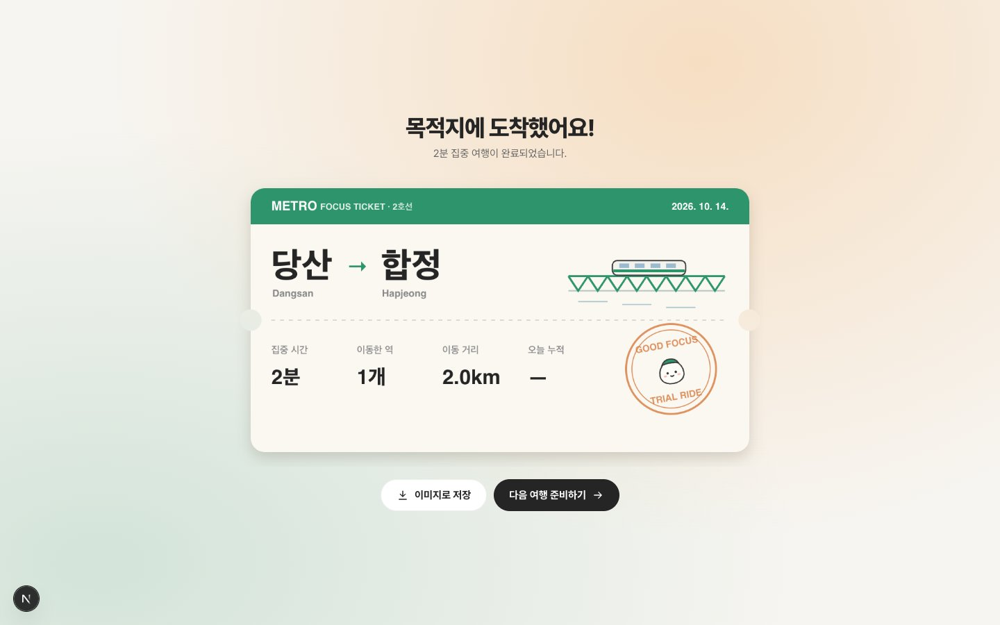

<div align="center">


# METRO

**서울을 달리는 뽀모도로**

집중하는 동안, 서울 지하철 창가에 앉아 한 구간을 함께 달려요.

[](https://github.com/yohan-work/pomotro/actions/workflows/ci.yml)
[](LICENSE)
[](#데이터와-출처)
[](https://nextjs.org)
[](tsconfig.json)
[](https://pomotro.vercel.app)

**[▶ 지금 타보기 — pomotro.vercel.app](https://pomotro.vercel.app)**

[빠른 시작](#빠른-시작) · [동작 방식](#동작-방식) · [아키텍처](docs/architecture.md) · [기여하기](CONTRIBUTING.md) · [이슈](https://github.com/yohan-work/pomotro/issues)



</div>

---

## 소개

METRO는 집중 시간을 **작은 서울 여행**으로 바꾸는 웹 뽀모도로 타이머입니다.

집중할 시간을 고르면 그 시간에 맞는 실제 2호선 구간을 추천합니다. 출발하면 객실 창가 시점에서 열차가 문을 닫고, 부드럽게 가속하고, 한강 철교를 건너고, 터널을 지나 다음 역에 감속하며 들어섭니다. 목적지에 도착하면 집중 세션이 끝나고 승차권을 받습니다.

> 집중하는 모든 순간이, 좋은 곳으로 데려다줄 거예요.

<details>
<summary><b>In English</b></summary>

METRO is a Pomodoro timer that turns a focus session into a ride on Seoul Subway Line 2. Pick a duration and it suggests a real route of matching length; then you sit by the window while the train departs, accelerates, crosses the Han River, and brakes into the next station — all simulated in real time in the browser (Canvas 2D parallax + WebAudio). Route order, run times and distances come from Seoul Metro's official open data.

</details>

## 주요 기능

- **실제 노선 기반 여정** — 2호선 본선 순환 43개 역. 역 순서·표준 운행시간·거리는 서울교통공사 공식 데이터
- **시간에 맞춘 노선 추천** — 15·25·40·60분 또는 직접 입력. 한강 횡단·고가 구간을 우대하고, 실제 예상 시간과의 차이를 표시
- **창밖 2.5D 시뮬레이션** — 12개 시차 레이어, 고가 승강장 → 시가지 → 한강 철교 → 갱문 → 터널 → 지하 승강장
- **실제 지리 반영** — 당산철교에선 양화대교·선유도·하류 노을, 잠실철교에선 올림픽대교·롯데월드타워 (진행 방향 왼쪽 창 기준)
- **현실적인 운행** — 저크 없는 가감속, 정차·출입문, 주행 진동, 가감속에 흔들리는 손잡이
- **동네마다 다른 창밖** — 성수 붉은 벽돌 공장·카페, 구로디지털단지 유리 오피스, 신도림·잠실 고층 단지, 역마다 다른 승강장 마감
- **터널 교행 열차** — 반대 방향 열차가 창 앞을 스쳐 지나가는 순간 (우측통행 기준, 지나가는 소리 포함)
- **낮 · 노을 · 밤** — 한국 시간 기준 자동 전환
- **서울 실시간 날씨 · 계절** — 비 오는 날엔 창에 물방울이 맺히고 빗소리가, 눈 오는 날엔 지붕이 하얗게. 봄 벚꽃·여름 신록·가을 은행·겨울 나목 ([Open-Meteo](https://open-meteo.com), 키 불필요)
- **안내방송 (선택)** — "이번 역은 합정, 합정역입니다." 브라우저 내장 한국어 음성
- **합성 사운드** — 주행음·인버터음·레일 이음매·터널 울림·차임·출입문. 채널별 볼륨 조절, 외부 음원 없음
- **뽀모도로 사이클** — 도착하면 그 역 승강장에 정차한 채 휴식(기본 5분, 4회마다 15분 · 직접 설정), 휴식 후 같은 역에서 이어 타기 또는 자동 출발
- **할 일 체크** — 도착하면 "끝냈나요?" — 완료한 일은 승차권과 기록에 남음
- **노선도에서 직접 고르기** — 공식 거리 비율로 그린 2호선 순환 노선도에서 출발·도착역 선택
- **정확한 타이머** — 벽시계 기준. 일시정지·탭 전환·새로고침 후에도 어긋나지 않음. 다른 창에서 작업 중이면 탭 제목과 알림으로 도착을 알려줌
- **설치형 웹앱** — 홈 화면에 추가, 오프라인에서도 동작 (PWA)
- **집중 완료 승차권** — 집중 시간·이동한 역·실제 이동 거리. PNG 저장/공유
- **나의 서울 노선도** — 달린 구간과 방문한 역이 노선도에 쌓이고, 누적 시간·거리·연속 일수·최근 7일 기록과 지난 승차권을 다시 볼 수 있음. 기록 내보내기·가져오기
- **밤에는 어둡게** — 한국 시간 밤 또는 시스템 다크 모드에서 화면 전체가 어두운 테마로
- **집중 모드** — 5초간 입력이 없으면 버튼이 사라지고 창밖과 시간만 남음 (`H` 키로 전환)
- **접근성** — 모션 줄이기, 키보드(Space 일시정지 · H 집중 모드), 키보드로 고르는 노선도, 모바일 세로 레이아웃

## 스크린샷

| 노을 · 당산철교 | 밤 · 당산철교 | 낮 · 잠실철교 |
|:---:|:---:|:---:|
|  |  |  |
| **당산 고가 승강장** | **고가 시가지** | **터널** |
|  |  |  |
| **출발 화면** | **합정 도착** | **승차권** |
|  |  |  |

## 빠른 시작

설치 없이 **[pomotro.vercel.app](https://pomotro.vercel.app)** 에서 바로 써볼 수 있습니다. 홈 화면에 추가하면 앱처럼 쓸 수 있어요.

로컬에서 실행하려면 Node.js 24 이상이 필요합니다.

```bash
git clone https://github.com/yohan-work/pomotro.git
cd pomotro
npm install
npm run dev
```

<http://localhost:3000> 에서 **1분 50초 체험 운행 · 당산 → 합정** 을 눌러 보세요. 소리는 출발 버튼을 누른 뒤부터 재생됩니다.

개발용 URL 파라미터:

| 파라미터 | 예시 | 설명 |
|---|---|---|
| `autostart` | `?autostart=demo` | 체험 운행 바로 시작 |
| `route`, `total` | `?autostart=route&route=gangbyeon,jamsillaru&total=150` | 임의 구간 바로 시작 |
| `seek` | `&seek=45` | 시작 시점을 앞당김 |
| `tod` | `&tod=sunset` | 시간대 고정 (`day` `sunset` `night`) |
| `debug` | `&debug=1` | FPS·속도·상태 표시 |

## 스크립트

| 명령 | 설명 |
|---|---|
| `npm run dev` | 개발 서버 |
| `npm run build` / `npm start` | 프로덕션 빌드 (정적) / 실행 |
| `npm run typecheck` | TypeScript 검사 |
| `npm test` | 단위 테스트 (통계·추천·세션·뽀모도로) |
| `npm run test:sim` | 시뮬레이션 엔진 불변식 + 공식 데이터 정합성 |
| `npm run verify:browser -- <url> [--full]` | 실제 Chrome에서 장면 스냅샷·FPS·110초 완주 |
| `npm run verify:behavior -- <url>` | 일시정지·새로고침 복구·중복 기록·오디오 검사 |
| `npm run data:import` | 서울교통공사 공식 CSV를 받아 노선 데이터 재생성 |

## 동작 방식

```
epochNow() ─▶ 경과시간 t ─▶ sampleJourney(journey, t) ─▶ 위치 · 속도 · 가속도 · 상태
                                  │
              ┌───────────────────┼────────────────────┐
              ▼                   ▼                    ▼
       Canvas 2D 렌더러      WebAudio 엔진        DOM 객실 · HUD
       (12개 시차 레이어)     (속도 반응 사운드)     (React, ≤4Hz 갱신)
```

- **상태는 시간의 순수 함수**입니다. 프레임마다 값을 누적하지 않으므로 탭이 숨겨지거나 새로고침해도 같은 시각이면 같은 장면입니다.
- **집중시간과 실제 운행시간이 다르면** 재생 속도를 바꾸지 않고 터널·시가지 같은 연출 구간 길이를 늘리거나 줄입니다. 열차는 늘 현실적인 속도(약 76km/h)로 달립니다.
- **창밖 풍경**은 트랙 좌표 셀마다 결정론적으로 생성됩니다. 같은 위치에는 항상 같은 건물이 있고, 비싼 그림은 오프스크린 스프라이트로 캐시합니다. 데스크톱 기준 프레임당 렌더 약 1ms.

자세한 내용은 [docs/architecture.md](docs/architecture.md), 디자인 원칙은 [docs/design-system.md](docs/design-system.md)를 보세요.

## 프로젝트 구조

```
src/
├─ app/            Next.js App Router 진입점, 전역 스타일·디자인 토큰
├─ components/     객실 시뮬레이션 화면, 출발 화면, 승차권
├─ sim/            시간 기반 여정 엔진 (가감속 프로파일, 세션 시계)
├─ render/         창밖 Canvas 2D 렌더러 (레이어, 스프라이트, 팔레트)
├─ audio/          WebAudio 합성 사운드
├─ data/           실제 노선 데이터 · 공식 데이터(자동 생성) · 연출 데이터
├─ lib/            노선 추천
└─ store/          Zustand 상태 (세션·기록·설정, localStorage)
data/official/     공식 원본 CSV
scripts/           데이터 가져오기 · 엔진 검사 · 브라우저 검증
docs/              기획·아키텍처·디자인 시스템·단계별 기록
```

## 데이터와 출처

| 데이터 | 출처 | 상태 |
|---|---|---|
| 2호선 역 순서·역명, 역간 표준 운행시간, 역간 거리 | [서울교통공사 「역간거리 및 소요시간」](https://data.seoul.go.kr/dataList/OA-12034/S/1/datasetView.do) (서울 열린데이터광장, 2024-09-02 갱신) | 공식 |
| 역 정차시간 (30초) | 추정 | 화면에 "예상"으로 표시 |
| 역번호·영문 역명·지상/지하 구조 | 공개 정보 | 공식 대조 전 |
| 창밖 구간 길이·풍경 배치 | 연출용 가상 데이터 (`src/data/scenery.ts`) | 실제 측량값 아님 |

공식 데이터는 **공공누리 제1유형(출처표시)** 에 따라 이용합니다. 이 저작물은 서울교통공사에서 공공누리 제1유형으로 개방한 「서울교통공사_역간거리 및 소요시간」을 이용하였습니다.

실제 데이터와 연출 데이터는 파일 단위로 분리되어 있습니다. 데이터 오류를 발견하면 [데이터 정정 이슈](https://github.com/yohan-work/pomotro/issues/new?template=data_correction.yml)로 알려주세요.

## 로드맵

- [x] 핵심 시뮬레이션 — 출발·가속·한강 횡단·감속·정차 ([Phase 1](docs/phase-01.md))
- [x] 2호선 고가 구간과 잠실철교
- [x] 서울교통공사 공식 운행시간·거리 연동
- [x] 뽀모도로 휴식 사이클 · 이어 타기 · 도착 알림 · PWA
- [x] 출발역·도착역 직접 선택
- [x] 집중 모드와 화면 다듬기
- [x] Vercel 배포 (main 푸시 시 자동 배포)
- [x] 나의 서울 노선도 · 기록 화면
- [x] 터널 교행 열차, 동네별 풍경
- [ ] 다른 노선과 환승

전체 계획은 [docs/plan.md](docs/plan.md)에 있습니다.

## 기여하기

버그 제보, 데이터 정정, 풍경 아이디어 모두 환영합니다. 시작하기 전에 [CONTRIBUTING.md](CONTRIBUTING.md)와 [행동 강령](CODE_OF_CONDUCT.md)을 읽어주세요. 보안 문제는 [SECURITY.md](SECURITY.md)를 따라 비공개로 알려주세요.

## 라이선스

- 소스 코드: [MIT](LICENSE)
- 노선 데이터: 서울교통공사, 공공누리 제1유형 (출처표시)
- 글꼴: [Pretendard](https://github.com/orioncactus/pretendard) (SIL Open Font License 1.1, CDN 로드)

METRO는 서울교통공사·서울특별시와 관련이 없는 개인 프로젝트입니다. 화면 속 역명판과 안내 표시는 이해를 돕기 위한 자체 디자인입니다.
